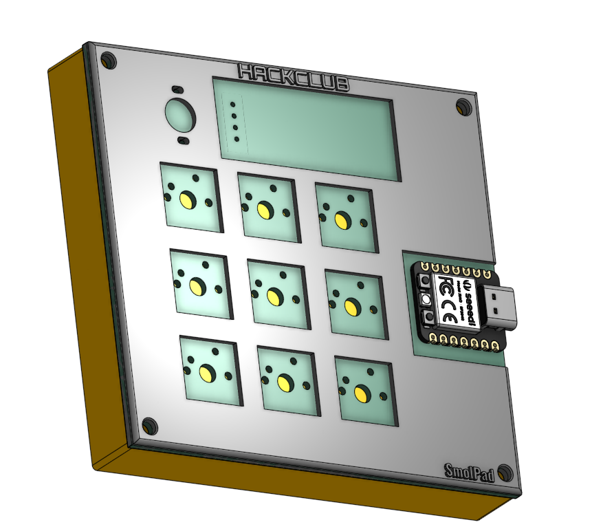
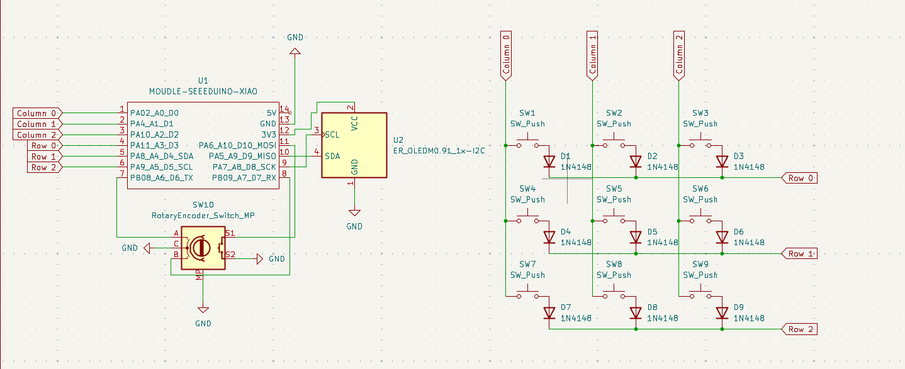
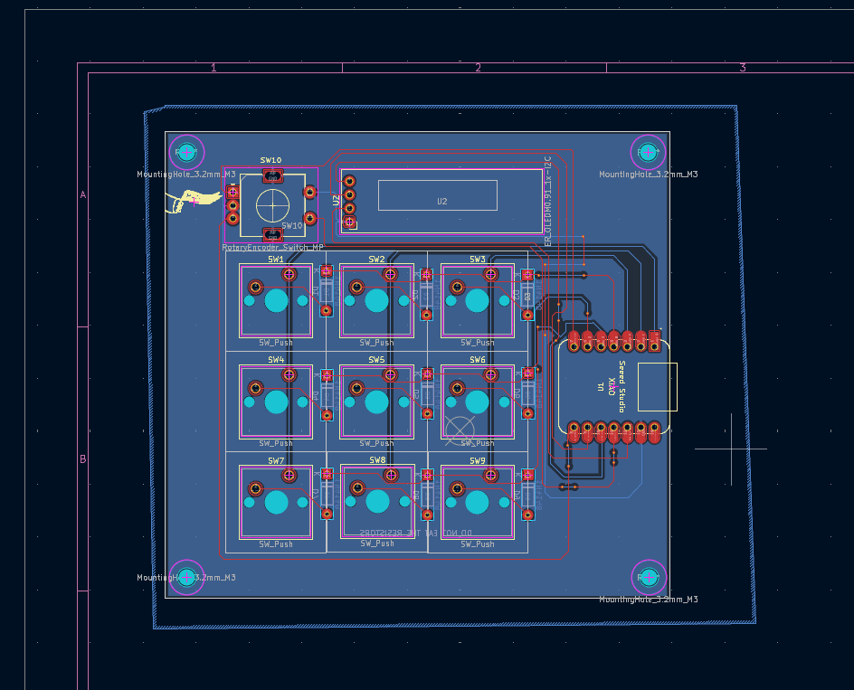

# SmolPad 

SmolPad is an open-source, custom 3x3 mechanical macropad powered by the Seeed Studio XIAO RP2040 microcontroller. It features a 3x3 diode key matrix, an EC11 rotary encoder for volume control, and a 0.91" I2C OLED display for a plain text output (for now) , all housed in a custom 3D-printed case running KMK Firmware .

# Features

 **3x3 Key Matrix:** Direct-soldered MX mechanical switches with 1N4148 diodes .
 **EC11 Rotary Encoder:** Smooth volume adjustment and press-to-mute functionality.
 **0.91" I2C OLED Display:** 128x32 resolution driven by the SSD1306 display controller displaying status information.
 **Compact Case Design:** Custom 2-piece case secured with M3 heat-set brass inserts.
 **Easy Customization:** Powered by KMK / CircuitPython—edit shortcuts on the fly by modifying `main.py` like a USB drive file.

Keymap
 Row 0 
  i) Media play/pause
  ii) Brightness Increase 
  iii) Brighness Decrease
 Row 1 
  i) Super/Windows key ( i know this one is weird but the one on my keyboard doesnt work so i will use this for the timebeing).
  ii) Audio Mute 
  iii) Copy ( Ctrl + C)
 Row 2
  i) Cut (ctrl + x)
  ii) Paste (ctrl + v)
  iii) undo (ctrl + z)

Rotary Encoder 
 i) Clockwise Turn - Volume Up
 ii) Counter-Clockwise - Volume Down
 iii) Push Switch Press - Mute Toggle ( will be later used to switch layers)

OLED Display 
i) currently Displays only a single static text i.e. Smolpad active 

All the Above can and will be most likely changed later on .

# Project Structure

HackPad
 CAD
  Top.step
  Top.stl
  Bottom.step
  Bottom.stl
  Hack Club Knurled Knob.step
 PCB
  smolpad.kicad_pcb
  smolpad.kicad_pro
  smolpad.kicad_sch
  smolpad.step
  gerbers(final).zip
 firmwarefiles
  boot.py
  kb.py
  main.py
  lib 
  kmk 
Imagaes
  Case
   Bottom.png
   Combined.png
   Top.png
  PCB 3d model.png
  Schematic.pdf
 BOM.csv
 README.md

NOTE :- PLEASE CHECK THE BOM.csv FOR THE MATERIALS

# Assembly instructions
PCB Fabrication: Upload production/gerbers/gerbers.zip to a PCB manufacturer (such as JLCPCB) with standard 1.6mm thickness and default settings.

3D Printing: Print the enclosure parts (smolpad_case_top.step and smolpad_case_bottom.step) .

Component Soldering: Solder the 1N4148 diodes onto the back of the pcb , ensuring correct polarity .
Solder the mechanical MX-style switches and the EC11 encoder 
Solder the Seeed Studio XIAO RP2040 microcontroller and the 0.91-inch OLED display
Enclosure Assembly: Mount the assembled PCB into the 3D-printed case using M3 screws.

# Firmware Flashing & Setup

The SmolPad runs on CircuitPython with KMK firmware using the Seeed Studio XIAO RP2040.
Enter Bootloader Mode: Connect the XIAO RP2040 to your computer via USB and double-tap the reset button. A drive named RPI-RP2 will appear.

Install CircuitPython Runtime: Drag and drop the official CircuitPython UF2 bootloader runtime onto the RPI-RP2 drive. The board will reboot and mount a new drive named CIRCUITPY.

Upload Firmware Files: Copy your firmware script files (main.py, kb.py, and the kmk/ library folder) directly into the root directory of the CIRCUITPY drive.

Test: The board will automatically execute main.py and initialize your keymap, rotary encoder, and OLED display.

 Acknowledgements :- i) Usage of Ai for understanding features of Kicad/Onshape , Usage of ai for guidance in few areas like firmware , Usage of ai for identifying errors and resolving them
 ii) All resources are not owned by me (except case and Pcb however you are free to use them if you want to).  
 iii) Created with the guidance of https://hackpad.hackclub.com/guide , https://youtu.be/8WXpGTIbxlQ?si=IzrQN_IX_nW7LFwR  .
 iv) Built with support from the Hack Club grants and resoureces —massive thanks to them for funding the hardware and making this project a reality.
 v) Built for Stardance hackclub 
 CONTACT INFO :- mandeepswami2010@gmail.com

Suggestions / Issues / Complaint(s) are accepted and appreciated for the betterment of the macropad.